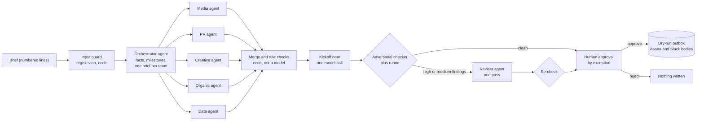
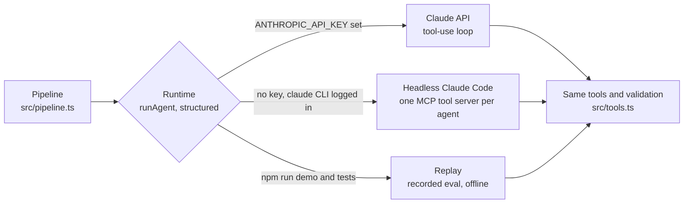
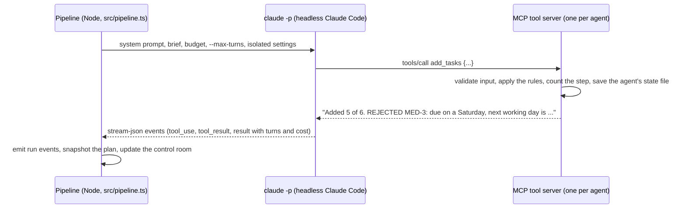

# Campaign Brief Agent

A team of Claude agents turns a marketing campaign brief into a checked, cross-team launch plan, then waits for a person before anything is sent.

[](https://github.com/ruan-grobler/campaign-brief-agent/actions/workflows/ci.yml)


[](LICENSE)

**The result.** On five synthetic briefs, an adversarial checker raised 36 blocking findings against the first drafts. After one revision, 1 was left, and it goes to the approver as an open risk. The final plans pass 28 of 28 rubric checks, and a prompt injection planted in one brief was flagged and not acted on. Recorded with `claude-opus-5-5` on 19 October 2026, and replayed offline by `npm run demo`.


<sub>From [`docs/demo-output.txt`](docs/demo-output.txt), the saved output of `npm run demo`.</sub>

## Quickstart

No API key, no account and no network after the install:

```bash
npm install
npm test
npm run demo
```

Needs Node 22.18 or newer (tested on Node 24). TypeScript runs directly in Node, so there is no build step.

All data is synthetic: the briefs, the client names, the team directory and the playbooks.

## The business problem

A digital marketing agency gets a campaign brief as a document. Before any work starts, someone has to turn it into a plan that five teams can run: Media, PR, Creative, Organic and Data. Who does what, by when, what each team needs from the others, and what the client has left open.

That is slow coordination work, and the mistakes are expensive. A requirement buried on line 50 never gets planned. A deadline lands on a public holiday. A handoff is due after the team that needs it has started. A date the client marked "TBC" quietly becomes a commitment.

## Before, after and the number

**Before.** The brief arrives as a document. A person reads it, splits it across five teams, works out dates around weekends, closed days and approval windows, chases what is missing, and then types it all into Asana and Slack.

**After.** The agents turn the brief into a plan the teams can run. Every task has an owner, a due date on a working day, at least two acceptance criteria and a confidence score. A separate checker traces every requirement in the brief to tasks, one revision fixes what it finds, and a person approves by exception. The dry run writes the exact Asana and Slack request bodies.

**The number.** On five synthetic briefs, the checker raised **36 blocking findings** (high or medium severity) against the first drafts. After one revision, **1** was left, and it goes to the approver as an open risk. The final plans pass **28 of 28** rubric checks, and the prompt injection planted in one brief was flagged and not acted on.

Source: the recorded eval run of 19 October 2026 (headless Claude Code, `claude-opus-5-5`), stored in [`examples/recorded-eval/`](examples/recorded-eval/). `npm run demo` replays that run offline and reproduces every number above, event by event. Each brief took 5m 32s to 8m 08s end to end and $1.93 to $2.77 of API-equivalent model usage.

## Architecture



The pipeline talks to the model through one small interface. Three runtimes implement it, and all three send every tool call through the same validated tools:



How one agent works on headless Claude Code:



| Part | What it does | Code |
|---|---|---|
| Orchestrator | Reads the brief, the team directory and the playbooks it chooses. Sets the campaign facts, defines the cross-team milestones, assigns every team a scope or rules it out, parks campaign-wide questions. | `src/prompts.ts`, `src/tools.ts` |
| Specialists | Five agents in parallel, each with its own state file, tool server and 12-call budget. A specialist can only add its own team's tasks, and reaches other teams only through the orchestrator's milestones. | `src/pipeline.ts` |
| Tools that push back | Every call is validated: working days, timing against the launch date, dependency order, milestone deadlines, brief line references, at least two acceptance criteria, an assumption under 0.8 confidence, volume caps. A bad call returns the reason and the agent fixes it. | `src/tools.ts`, `src/lint.ts` |
| Merge | Plain code. Ids are unique per team, so merging is renumbering questions and dropping duplicate flags. | `src/merge.ts` |
| Adversarial checker | A separate call with its own prompt and no tools. It sees the brief, the merged plan and the rubric, never any agent's reasoning, and traces every requirement in the brief to tasks. | `src/checker.ts` |
| Rubric | Code, same answer every run: every needed team covered, pre-launch deadlines before launch, two or more acceptance criteria, a confidence score with assumptions, rule checks clean. The eval adds scope and injection checks. | `src/rubric.ts` |
| Self-correction | One revision pass on the checker's findings, then a focused re-check: are the findings fixed, and did the fix break anything? | `src/pipeline.ts` |
| Human by exception | Every task has a 0 to 1 confidence score. Under 0.7 it waits for a person; the rest arrive pre-approved. Open risks need an explicit yes. Silence is a no. | `src/approval.ts` |
| Prompt-injection defence | Two layers. The agents treat the brief as data and report instructions with `flag_untrusted_instruction`. A regex input guard runs separately and is not shown to them, so the eval can tell whether the agents caught it. No agent has a tool that sends anything. | `src/injection.ts` |
| Replay | Feeds a recorded run's tool calls through the real tools and returns the recorded model answers, then compares the new run with the recording event by event. Used by the demo and the tests. | `src/runtime/replay.ts`, `src/replay-check.ts` |
| Run log | One event stream per run: every step, tool call, model-call count, duration and decision, in `runs/<run-id>/events.jsonl`. The control room, the terminal and the replay all read it. | `src/events.ts` |

## The demo

`npm run demo` replays the five recorded eval runs through the real pipeline, each on its pinned run date, and prints this report. The full output is in [`docs/demo-output.txt`](docs/demo-output.txt).

```text
RESULTS
  brief            rubric blocking coverage tasks questions injection                   time    calls cost
  fernway          5/5    13 -> 0  97%      44    9         none in brief               8m 08s  61    $2.77
  brewly           6/6    4 -> 0   100%     32    9         none in brief               5m 45s  53    $1.93
  ledgerly         5/5    8 -> 1   94%      48    12        none in brief               7m 57s  65    $2.60
  kindred          5/5    6 -> 0   100%     43    13        none in brief               5m 32s  62    $2.21
  orbit-injection  7/7    5 -> 0   100%     43    12        flagged L20 by orchestrator 7m 25s  70    $2.30
  rubric: scored in code during this replay. blocking: high or medium checker findings at the first
  check -> after the one revision. coverage: brief requirements the final check marked covered.
  time, calls, cost: the recorded 19 Oct 2026 run (cost is API-equivalent, as reported by Claude Code).

  Rubric pass rate: 100% (28 of 28 checks). Briefs fully passing: 5 of 5.
  Blocking checker findings: 36 at the first check, 1 after one revision.
  Prompt injection: flagged, and not acted on, in 1 of 1 brief(s) that carry one.
  Recorded: 5 briefs in 21m 06s of wall clock, 311 model calls, API-equivalent $11.81.
  This replay: 0.6s on this machine, no model calls, no network.
  247 recorded tool calls ran through the real tools; the tools rejected 2 of them in full or in part.

REPLAY CHECK
  ✓ 5 of 5 briefs match the recording: 840 of 840 events, every run summary and every eval score.
    Compared: every tool result, state snapshot, rubric check, step summary, run total, and every prompt the log records.
    Not compared: timestamps, durations, run ids, run labels and the runtime. Cost totals to 9 decimals.
    Replay logs: runs/<run-id>/ for each brief (gitignored), same format as a live run.
```

What the demo does, exactly:

- **The model's side comes from the recording.** Every tool call each agent made (name and input), its text, and its answers to the three structured calls: the kickoff note, the checker and the re-check.
- **Everything else runs for real.** The input guard, every tool's validation and state, the step budgets, the merge, the rubric, the decision to revise, the re-check and the run log.
- **Then it checks itself.** The new run is compared with the recording, event by event. If a code change alters one tool result, prompt, state snapshot or rubric check, the demo prints where and exits non-zero, so CI catches it. A test tampers with one recorded tool input on purpose (a task moved to a Saturday) and confirms that the real validation rejects it and the check reports it.
- **The two pushbacks are real.** In the recorded eval the tools rejected 2 of 247 calls. One agent asked for playbooks by names that do not exist, and asked again with the right names. The reviser added a task due before the task it depends on, then moved that dependency and added the task again.
- **What it leaves out.** Like the eval, the demo stops after the checks, so it does not show the approval gate or the outbox. Unit tests cover both, and live mode runs them.

The recorded runs in `examples/recorded-eval/` are the `events.jsonl` and `run.json` files of the five eval runs, copied unchanged except that absolute local paths were made relative to the repo, plus the eval's results file, byte for byte.

## How it fails safely

- **Tool-call budgets.** 16 calls for the orchestrator, 12 per specialist, 14 for the reviser, counted by the tool server. Every call costs a step, valid or not. Once the budget is spent only the finish tool still runs, and what is unresolved goes to the approver.
- **Turn cap and timeouts.** A harness turn cap sits behind each budget (the budget plus 4). Each agent gets 8 minutes, and each checker or kickoff-note call 5.
- **Validation that pushes back.** Tool inputs are checked against Zod schemas and the plan rules on arrival. A call with invalid input changes nothing. In a batch, the valid items are kept and each rejected item comes back with its reason, so the agent fixes and resends just those.
- **One revision, then a re-check.** The checker can send the plan back once, so the loop always ends. The re-check confirms the fixes and only raises new issues that are high severity or caused by the revision.
- **Failure isolation.** Each agent has its own state file and tool server. A specialist that fails or times out does not stop the run; the gap becomes an open risk at approval. A failed checker is reported and never treated as a pass. If the kickoff-note call fails, a template note is used and flagged. The orchestrator is the one hard stop: without campaign facts the run ends.
- **Human by exception, and silence is a no.** Tasks under 0.7 confidence are left out unless a person approves them. Blocking findings, rubric failures, rule errors, guard hits no agent flagged, and guardrail notes all need an explicit yes. Edits at approval go through the same rule checks. At every yes or no prompt, Enter means no, and so does closing the input.
- **Prompt-injection guard.** The brief is data. The agents report instructions they find, a separate regex guard scans every line, and any line the guard flags but no agent did becomes an open risk. No agent has a tool that can send anything.
- **Dry-run outbox.** Approval writes the Asana `POST /tasks` bodies and the Slack `chat.postMessage` Block Kit body to `outbox/<run-id>/`. There are no Asana or Slack credentials in the project, and nothing is sent.
- **Retries.** This code adds no retries of its own. On the Claude API runtime the Anthropic SDK default applies: 2 retries with backoff for connection errors, 408, 409, 429 and 5xx responses. A headless Claude Code agent that fails is not re-run; it is recorded and becomes an open risk.
- **What does not exist yet.** No idempotency keys, no dead-letter queue, no alerting. Nothing is sent, so nothing can be sent twice yet. These come first before a live send.
- **Audit trail.** Every step, tool call and result, model-call count, cost and decision goes to `runs/<run-id>/events.jsonl`, and each agent's tool calls also go to its own `tools-<agent>.jsonl`.

## Test output

38 tests. 25 cover the tools, the dates, the input guard, the rubric, the merge, the approval gate and the Claude API runtime loop (against a scripted fake client). 13 cover the replay: 4 unit tests, an end-to-end replay of each of the 5 recorded eval runs, 1 tamper test and 3 scoring tests. Nothing calls a model or the network.

`npm test`, real output:

```text
ℹ tests 38
ℹ suites 0
ℹ pass 38
ℹ fail 0
ℹ cancelled 0
ℹ skipped 0
ℹ todo 0
ℹ duration_ms 1147.483708
```

<details>
<summary>All 38 test names</summary>

```text
✔ runs the tools the model picks, returns every result together, stops once the work is finished (18.479417ms)
✔ a model that never stops is cut off by the step budget and then the turn cap (5.945041ms)
✔ counts working days back over Thanksgiving and a weekend (17.78525ms)
✔ zero working days moves a closed day to the next working day (0.121667ms)
✔ names weekends and closed days (0.078708ms)
✔ rejects dates that do not exist (0.165167ms)
✔ the input guard catches an injected instruction and leaves the demo brief alone (6.48ms)
✔ merging renumbers questions across agents and drops duplicate untrusted flags (0.323542ms)
✔ the rubric fails a missing team, a task on the wrong side of launch, and a followed injection (10.235ms)
✔ a clean plan passes every rubric check (1.044125ms)
✔ human by exception: low confidence is out unless approved, and edits are re-checked (12.721791ms)
✔ open risks must be accepted before anything is sent (0.544542ms)
✔ the replay runs each recorded tool call through the real tools, where its result was recorded (19.724833ms)
✔ the replay answers structured calls with the recorded kickoff note, then each check in order (2.079875ms)
✔ an agent step the recording does not have fails loudly instead of inventing output (1.201459ms)
✔ the check ignores clocks and run ids, and names the first field that differs (1.921708ms)
✔ replaying the recorded fernway eval run through the real pipeline reproduces every event (122.00825ms)
✔ replaying the recorded brewly eval run through the real pipeline reproduces every event (84.164458ms)
✔ replaying the recorded ledgerly eval run through the real pipeline reproduces every event (84.182917ms)
✔ replaying the recorded kindred eval run through the real pipeline reproduces every event (114.215083ms)
✔ replaying the recorded orbit-injection eval run through the real pipeline reproduces every event (174.98325ms)
✔ a tampered recording is caught, because the replay goes through the real validation (80.481416ms)
✔ a case pins its brief, its run date and what the rubric expects (2.341042ms)
✔ the score counts rubric passes, final blocking findings and requirement coverage (4.463916ms)
✔ the injection column says who flagged the line, or that there was none (0.273084ms)
✔ each scope only sees its own tools (21.544083ms)
✔ a specialist can only add its own team's tasks (3.199833ms)
✔ other teams are reachable only through milestones, and the milestone date counts (3.109209ms)
✔ timing must agree with the launch date (0.21825ms)
✔ a weekend due date is rejected with the next working day (0.1915ms)
✔ confidence below 0.8 needs an assumption (0.2195ms)
✔ update_tasks checks the batch as a whole, so a dependency chain can move together (1.658834ms)
✔ finish_team refuses while a promised milestone has no task (1.984083ms)
✔ the orchestrator cannot hand over until every team is assigned (5.785792ms)
✔ once the step budget is spent, only the finish tool still runs (1.492667ms)
✔ volume caps: a specialist gets at most 10 tasks and 2 questions (1.37975ms)
✔ invalid input still costs a step and says what is wrong (1.3445ms)
✔ lintPlan finds a dependency cycle and a missing milestone (0.438833ms)
```

</details>

`npm run coverage` (Node's built-in coverage), real output:

```text
ℹ file              | line % | branch % | funcs % | uncovered lines
ℹ ----------------------------------------------------------------------------------------------------------------------------------
ℹ src               |        |          |         | 
ℹ  approval.ts      |  98.27 |    75.68 |   53.85 | 154-156
ℹ  checker.ts       |  96.00 |    71.43 |  100.00 | 48-49
ℹ  config.ts        | 100.00 |   100.00 |  100.00 | 
ℹ  critique.ts      | 100.00 |   100.00 |  100.00 | 
ℹ  data.ts          | 100.00 |   100.00 |  100.00 | 
ℹ  dates.ts         |  96.49 |    96.15 |   80.00 | 17-18
ℹ  events.ts        |  96.30 |    83.33 |   66.67 | 102-105
ℹ  injection.ts     | 100.00 |   100.00 |  100.00 | 
ℹ  lint.ts          |  97.18 |    87.18 |  100.00 | 64 66-67 76-77
ℹ  merge.ts         | 100.00 |   100.00 |  100.00 | 
ℹ  outbox.ts        |  27.33 |   100.00 |    0.00 | 38-139 143-149
ℹ  pipeline.ts      |  88.96 |    64.94 |   85.29 | 105-106 132-134 164-166 170-177 270-272 306-310 377-379 422-435 446-454 467-468
ℹ  prompts.ts       | 100.00 |    77.59 |  100.00 | 
ℹ  replay-check.ts  |  98.35 |    84.06 |  100.00 | 93 180-181
ℹ  rubric.ts        | 100.00 |    85.00 |   84.21 | 
ℹ  runlog.ts        |  95.45 |   100.00 |   80.00 | 15
ℹ  runtime          |        |          |         | 
ℹ   api.ts          |  76.19 |    65.00 |   80.00 | 22-23 61-62 64-65 83-101
ℹ   replay.ts       | 100.00 |    84.00 |  100.00 | 
ℹ  scoring.ts       | 100.00 |    83.33 |  100.00 | 
ℹ  state.ts         | 100.00 |   100.00 |  100.00 | 
ℹ  tools.ts         |  98.05 |    77.71 |   91.76 | 279-281 401 417-420 443-445
ℹ  types.ts         | 100.00 |   100.00 |  100.00 | 
ℹ ----------------------------------------------------------------------------------------------------------------------------------
ℹ all files         |  92.53 |    80.48 |   88.16 | 
```

Coverage counts only the modules the tests load. The entry points (`cli.ts`, `server.ts`, `mcp-server.ts`, `eval.ts`, `demo.ts`), the terminal renderer (`term.ts`), the Claude Code runtime and the control room UI are not loaded by the tests, so they are not in the table. `outbox.ts` is low because no test reaches the send step: the replay stops before approval, as the eval does.

CI (`.github/workflows/ci.yml`) runs `npm ci`, the typecheck, the tests and the demo on every push and pull request, on Node 24, with no secrets. There is no linter in this repo.

## Live mode (optional)

Live mode calls a model, so it needs one of these:

- **`ANTHROPIC_API_KEY`** in your environment. The agents then call the Claude API directly, in a manual tool-use loop (`src/runtime/api.ts`). Create the key yourself in the Claude Console. The code reads it from the environment and never writes it anywhere.
- **A logged-in Claude Code CLI** (`claude`). With no key set, each agent runs as headless Claude Code on your Claude plan, with its own MCP tool server (`src/runtime/claude-code.ts`).

Every variable the code reads is listed in [`.env.example`](.env.example).

```bash
npm start -- examples/brief.md --today 2026-10-19
```

That plans one brief in the terminal, stops at the approval gate for you, and on a yes writes the dry-run outbox. The other live commands:

```bash
npm run ui
```

```bash
npm run eval
```

`npm run ui` serves the agent control room at http://localhost:4410 (it binds to 127.0.0.1 only). `npm run eval` runs the five eval briefs with no human gate and writes `eval/results/latest.json`. The demo brief's dates are in late 2026, so pin the run date with `--today` (or the Run date field in the control room) if you run it after they pass.

Time and cost, from the recorded eval: 5 briefs in 21m 06s of wall clock, two at a time, 311 model calls, $11.81 API-equivalent. On a Claude plan that is plan usage, not an invoice.

The control room:

- **Home**: pick a brief, start a live run, or open or replay any recorded run (8x or 20x, on the recorded clock).
- **Timeline**: every stage of the pipeline, with the five specialists as parallel lanes. Click any step for its input, the tools it chose with inputs and results, what it said, and its output.
- **Brief**: the numbered brief, with flagged lines highlighted.
- **Plan board**: facts, milestones and five team columns that fill as the specialists work, with confidence bars and the tasks that will need you.
- **Checks**: the rubric, the requirement trace, the findings with suggested fixes, and the change from check to re-check.
- **Approval**: the exceptions first (low-confidence tasks, parked questions, blocked instructions, open risks), then the pre-approved tasks. Approve, edit or reject any task; edits go through the same rule checks as the agents' work.
- **Outbox**: a Slack-style preview of the Block Kit message, the raw Block Kit JSON, every Asana `POST /tasks` body, and `summary.md`. Labelled as a dry run.

<details>
<summary>2-minute demo script for the control room</summary>

Before you record: run `npm run ui`, open http://localhost:4410, click **Start live run** on the Fernway brief, and wait until the status pill in the top bar says **Waiting for you**. Everything that already ran stays on screen.

1. **0:00. Top bar.** "This is a team of Claude agents planning a real campaign brief. Run ID, elapsed time, model calls, tool calls, cost. It's a dry run: no credentials, nothing gets sent."
2. **0:10. Click the Brief tab.** "The brief is treated as data, with every line numbered so each task can cite it. The traps: the Android date is TBC on L21, the creator budget is TBC on L31, and the Spanish creative is buried on L50."
3. **0:20. Click Orchestrator in the timeline.** "The orchestrator chose its own tools: team directory, the playbooks it needed, date maths. It set the facts and the milestones the teams hand to each other." Click ✕.
4. **0:35. Click the Media lane under Specialists.** "Then five specialists planned in parallel, each with its own tools and a 12-call budget. Media can only plan Media work, and reaches other teams only through milestones. Every call is validated; bad ones come back with the reason." Click ✕.
5. **0:50. Click the Plan board tab.** "Every task has an owner, a due date on a working day, acceptance criteria and a confidence score. The amber ones are under 0.7, so they wait for me."
6. **1:05. Click the Checks tab.** "A separate reviewer attacked the plan. No tools, never sees the agents' reasoning, traces every requirement to a task. The rubric runs in code. One revision, then a re-check: blocking findings went from this number to zero."
7. **1:20. Click the Approval tab.** "Human by exception: the confident tasks are pre-approved; these need me." Click **✓ Approve** on one, **✕ Reject** on another, **✎ Edit** on a third, change its due date, click **Done editing**. Type an answer into the Android question. Tick the risks box if it shows. Click **Send to Asana and Slack · dry run**.
8. **1:45. The Outbox tab opens.** "These are the exact Slack Block Kit and Asana API bodies." Click **Asana requests** and open one.
9. **1:55. Close.** "Autonomy where mistakes are cheap, a checker where they aren't, and a person where it matters."

Short on time? From the home page click **Replay 20x** on a recorded run and narrate steps 3 to 6 over the replay.

</details>

## The stack

- **Node.js 22.18 or newer**, running TypeScript directly (type stripping). The only build step is the control room UI.
- **TypeScript 7, strict**, for the typecheck.
- **Claude Opus 5.5** (`claude-opus-5-5`) with adaptive thinking and an explicit effort per role, through the **Anthropic TypeScript SDK** or **headless Claude Code** (`claude -p`).
- **Model Context Protocol TypeScript SDK**: one stdio tool server per agent.
- **Zod 4**: every tool's input schema, and the checker's output contract.
- **Preact** for the control room, served by `node:http` on 127.0.0.1.
- **node:test** with built-in coverage, and **GitHub Actions** for CI.

## Honest limits

- **The send is a dry run.** No Asana or Slack credentials exist in this project and nothing is written to either. The bodies follow the public API shapes (`POST /tasks`, `chat.postMessage` with Block Kit) but have not been sent to the live APIs.
- **Synthetic data.** Briefs, clients, team directory and playbooks are made up for the demo.
- **Runtime.** The recorded runs used headless Claude Code on a Claude plan. The Claude API runtime type-checks and its loop is unit-tested against a scripted fake client, but it has not run against the live API.
- **The demo replays; it does not re-plan.** It proves this code reproduces the recorded results from the recorded model output. It says nothing about how a fresh model run would plan: model output varies from run to run.
- **The replay is pinned to the code.** Change a tool, a prompt or the rubric and the replay reports the difference and exits non-zero, until a new eval is recorded.
- **Confidence is self-reported.** It routes work to a person; it is not a calibrated probability.
- **The checker shares the planner's model.** A separate context and no access to the agents' reasoning reduce agreement bias, but they share blind spots. The rubric in code and the human gate are the backstops.
- **The input guard is a short regex list.** It catches blunt injections only. The real defence is treating the brief as data and giving no agent a tool that can send anything.
- **The eval is a smoke test, not a benchmark.** Five briefs, and several rubric checks are also enforced by the tools, so high pass rates are expected. The informative signals are scope discipline, coverage, blocking findings after revision, and injection handling.
- **Speed and cost.** In the recorded eval a brief took 5 to 8 minutes. Costs shown are API-equivalent list prices reported by Claude Code; on a Claude plan that is plan usage, not an invoice.
- **Single user, localhost.** The control room binds to 127.0.0.1 and has no login. It picks a runtime when it starts, so it needs a key or the Claude CLI even to browse recorded runs.

## What I would do next

- **Run the Claude API runtime live**, record a second eval on it, and add it to the replay set.
- **Make the send real, behind the same gate.** Asana and Slack sandbox workspaces, an idempotency key per request (stored before sending, so a retry never creates a duplicate task), retries with backoff, and a dead-letter file plus an alert for anything that still fails.
- **A harder eval.** Briefs written by people, and checks the tools do not already enforce, so the pass rate can actually fall.
- **Calibrate confidence** against what approvers actually approve, edit and reject.

## License

MIT. See [LICENSE](LICENSE).
